# System Architecture & Technical Specifications
## Bus Reservation and Management System (BRMS)

---

## 1. Architectural Overview

The **Bus Reservation and Management System (BRMS)** is engineered as an enterprise-grade desktop client application following a strict **4-Tier Modular Layered Architecture**. The architecture isolates concerns across presentation, business orchestration, data persistence, and relational storage.

```mermaid
flowchart TD
    subgraph Presentation_Layer["1. Presentation Layer (PySide6 / Qt)"]
        UI_Main["Main Navigation Window (RBAC Router)"]
        UI_Admin["Admin Management Views (Fleet, Routes, Schedules, Reports)"]
        UI_Passenger["Passenger Views (Bus Search, Interactive Coach Seat Selector, My Bookings)"]
        UI_Conductor["Conductor Onboard Portal (Trip Manifest, OpenCV Live QR Scanner, Manual Verification)"]
        UI_Dialogs["Modals: Auth, E-Ticket Viewer, Payment Checkout, Schedule Builder"]
        UI_Charts["Embedded Matplotlib Revenue & Occupancy Visualizations"]
    end

    subgraph Business_Logic_Layer["2. Business Logic Layer (Services)"]
        Svc_Auth["AuthService (Bcrypt / PBKDF2 Session Security)"]
        Svc_Booking["BookingService (Atomic Reservation Workflow)"]
        Svc_Cancel["CancellationService (Tiered Refund Calculation & Waitlist Trigger)"]
        Svc_Waitlist["WaitlistService (FIFO Queue Priority & Auto-Allocation)"]
        Svc_Verify["VerificationService (QR Token Parsing & Conductor Validation)"]
        Svc_Report["ReportService (Aggregations, KPI Cards, CSV Export)"]
    end

    subgraph Data_Access_Layer["3. Data Access Layer (Repositories)"]
        Repo_User["UserRepository"]
        Repo_Passenger["PassengerRepository"]
        Repo_Bus["BusRepository"]
        Repo_Route["RouteRepository"]
        Repo_Schedule["ScheduleRepository"]
        Repo_Seat["ScheduleSeats (Inventory)"]
        Repo_Booking["BookingRepository"]
        Repo_Payment["PaymentRepository"]
        Repo_Refund["RefundRepository"]
        Repo_Waitlist["WaitlistRepository"]
        Repo_Checkin["CheckinRepository"]
        Repo_Report["ReportRepository"]
    end

    subgraph Database_Layer["4. Relational Database Layer (Dual Adapter)"]
        DB_Adapter["app/database.py (Unified MySQL 8.x / SQLite Adapter)"]
        DB_MySQL["MySQL 8.x Engine (InnoDB, Stored Procedures, Views, Triggers)"]
        DB_SQLite["Local Portable SQLite 3 Engine (WAL Mode, BEGIN IMMEDIATE)"]
    end

    Presentation_Layer --> Business_Logic_Layer
    Business_Logic_Layer --> Data_Access_Layer
    Data_Access_Layer --> DB_Adapter
    DB_Adapter --> DB_MySQL
    DB_Adapter -. Fallback .-> DB_SQLite
```



---

## 2. Layer Responsibilities

### 2.1 Presentation Layer (`app/ui/`)
- **Technology**: PySide6 (Qt for Python 6.12).
- **Core Components**:
  - `MainWindow`: Orchestrates user authentication state, dynamic sidebar menus conditioned on RBAC role, and stack widget view switching.
  - `BusSearchPage`: Multi-criteria search (origin, destination, travel date), real-time seat availability, bus type filters, and one-click booking launches.
  - `SeatSelectionDialog`: Dynamic 2x2 coach visual seating layout with aisle representation, driver cabin, status color coding (Available, Selected, Occupied), and minimum width protection.
  - `TicketDialog`: Digital E-ticket receipt with embedded `QPixmap` QR code and one-click ReportLab PDF boarding pass download.
  - `ConductorPage`: Live OpenCV video camera stream (`cv2.VideoCapture`) for hands-free QR code verification, trip passenger manifests, manual reference check-in, and instant sound/color feedback.
  - `ReportsPage`: Analytical dashboard showing live revenue KPIs, load factor stats, and embedded Matplotlib route performance charts.

### 2.2 Business Logic Layer (`app/services/`)
- Encapsulates business validation rules and multi-step transaction lifecycles.
- **Key Services**:
  - `AuthService`: Enforces salted password hashing, multi-role session tracking (`current_user`), and role assertion methods (`is_admin()`, `is_conductor()`, `is_passenger()`).
  - `BookingService`: Coordinates seat validation, atomic database locking, payment simulation, and booking reference generation.
  - `CancellationService`: Computes tiered cancellation penalties:
    - Departure > 24 hours: **100% refund** (0% fee).
    - Departure 12 - 24 hours: **75% refund** (25% fee).
    - Departure < 12 hours: **50% refund** (50% fee).
  - `WaitlistService`: Manages FIFO passenger queue ordering and coordinates auto-allocation when full trips experience cancellations.
  - `VerificationService`: Validates digital QR ticket payloads, verifies trip matching and payment confirmation, and flags duplicate or cancelled tickets.

### 2.3 Data Access Layer (`app/repositories/`)
- Encapsulates all SQL execution, parameter binding, and result set hydration.
- Prevents SQL injection by enforcing parameterized queries across all database drivers.
- Isolates table-specific schema knowledge from the UI and service layers.

### 2.4 Database Layer (`app/database.py` & `database/`)
- Provides a unified database gateway supporting:
  1. **Production Mode (MySQL 8.x InnoDB)**: Enterprise engine utilizing connection pooling (`mysql.connector.pooling`), row-level locks, views, stored procedures, and triggers.
  2. **Portable Test Mode (SQLite 3)**: In-process database running in WAL mode with `PRAGMA foreign_keys = ON;`, `isolation_level=None` for manual `BEGIN IMMEDIATE` transactions, and parameter transposition (`%s` -> `?`).

---

## 3. Concurrency & Transaction Management

A core technical challenge in bus reservation systems is the **Double-Booking Race Condition**, where two concurrent passengers simultaneously attempt to reserve the last remaining seat on a bus.

```mermaid
sequenceDiagram
    autonumber
    actor Passenger A
    actor Passenger B
    participant Booking Service
    participant Database (InnoDB / SQLite)

    Passenger A->>Booking Service: Request Seat 15 (Schedule 4)
    Passenger B->>Booking Service: Request Seat 15 (Schedule 4)
    
    activate Database (InnoDB / SQLite)
    Note over Database (InnoDB / SQLite): START TRANSACTION / BEGIN IMMEDIATE
    Booking Service->>Database (InnoDB / SQLite): Lock Seat 15 (SELECT ... FOR UPDATE)
    Database (InnoDB / SQLite)-->>Booking Service: Passenger A gains lock; Seat 15 = 'AVAILABLE'
    
    Note over Database (InnoDB / SQLite): Passenger B's transaction waits for lock
    Booking Service->>Database (InnoDB / SQLite): UPDATE schedule_seats SET seat_status = 'BOOKED' WHERE seat = 15
    Booking Service->>Database (InnoDB / SQLite): INSERT INTO bookings (schedule_id, seat_number, status) VALUES (4, 15, 'CONFIRMED')
    Booking Service->>Database (InnoDB / SQLite): INSERT INTO payments (...)
    Booking Service->>Database (InnoDB / SQLite): COMMIT TRANSACTION
    deactivate Database (InnoDB / SQLite)
    
    Database (InnoDB / SQLite)-->>Booking Service: Passenger A Booking SUCCESS (BUS-20261031-XXXX)
    
    activate Database (InnoDB / SQLite)
    Note over Database (InnoDB / SQLite): Passenger B's transaction acquires lock
    Booking Service->>Database (InnoDB / SQLite): Evaluate Seat 15
    Database (InnoDB / SQLite)-->>Booking Service: Seat 15 = 'BOOKED'
    Booking Service->>Database (InnoDB / SQLite): ROLLBACK TRANSACTION
    deactivate Database (InnoDB / SQLite)
    
    Booking Service-->>Passenger B: ERROR: Seat 15 is no longer available. Please select another seat.
```

### Concurrency Guarantees:
1. **Authoritative Per-Schedule Seat Inventory (`schedule_seats`)**:
   Instead of calculating seat availability via loose aggregates during writes, every physical seat exists as an explicit row in `schedule_seats`. Row-level locks directly serialize concurrent requests.
2. **Partial Unique Constraint Enforcement**:
   ```sql
   CREATE UNIQUE INDEX idx_bookings_active_seat
   ON bookings (schedule_id, seat_number)
   WHERE booking_status = 'CONFIRMED';
   ```
   Even under extreme concurrent load, the database engine enforces physical uniqueness at the disk page index level.
3. **Multi-Threaded Concurrency Testing**:
   Verified by `tests/test_booking.py::test_concurrent_booking_safety`, where 5 worker threads concurrently attempt to book the identical seat. Exactly 1 thread succeeds; the other 4 are cleanly rejected without deadlocks or corrupted records.

---

## 4. Role-Based Access Control (RBAC) Security Architecture

The application enforces a strict role-based permission matrix across all application layers:

| Capability / Resource | ADMIN | CONDUCTOR | PASSENGER | Anonymous / Guest |
|---|:---:|:---:|:---:|:---:|
| Search Bus Schedules | Yes | Yes | Yes | Yes |
| View Live Seat Availability | Yes | Yes | Yes | Yes |
| Select & Book Seats | Yes | No | Yes | No (Prompted to Login) |
| Download QR / PDF Tickets | Yes | No | Yes (Own Tickets) | No |
| Cancel Bookings & Claim Refunds | Yes (Any) | No | Yes (Own Tickets) | No |
| Manage Fleet (Buses CRUD) | Yes | No | No | No |
| Manage Routes & Stops | Yes | No | No | No |
| Create & Publish Schedules | Yes | No | No | No |
| View Financial Reports & Charts | Yes | No | No | No |
| View System Audit Logs | Yes | No | No | No |
| Onboard Trip Manifest Viewer | Yes | Yes | No | No |
| Scan & Verify QR Tickets (Camera) | Yes | Yes | No | No |
| Manual Reference Ticket Check-In | Yes | Yes | No | No |

---

## 5. Digital Ticketing & QR Verification Pipeline

1. **Token Generation (`app/utils/qr_generator.py`)**:
   Upon successful booking confirmation, the system generates a secure JSON payload:
   ```json
   {
       "booking_ref": "BUS-20261031-7A8B9C",
       "passenger_name": "Aarav Sharma",
       "schedule_id": 1,
       "seat_number": 15,
       "total_amount": 550.00,
       "source": "Pune",
       "destination": "Mumbai",
       "departure": "2026-11-01 07:00:00",
       "checksum": "sha256-signature"
   }
   ```
   The payload is rendered into a high-contrast QR code image (`qrcode.QRCode(box_size=10, border=2)`) using standard error correction (ErrorCorrectionLevel `M`).

2. **ReportLab PDF Boarding Pass Generation (`app/utils/pdf_generator.py`)**:
   - Generates a PDF boarding pass utilizing ReportLab's `SimpleDocTemplate`, `Paragraph`, `Table`, and `Image` flowables.
   - Includes passenger details, journey itinerary, bus type, seat number, barcode/QR visual, and terms and conditions.

3. **Conductor Onboard Scanner (`app/ui/pages/conductor_page.py`)**:
   - Uses OpenCV (`cv2.VideoCapture` + `cv2.QRCodeDetector`) running in a responsive PySide6 thread timer (30 FPS).
   - Detects QR bounding boxes, extracts the ticket reference, calls `verification_service.verify_ticket()`, checks against `ticket_checkins` for duplicates, records check-in timestamp, and provides real-time audiovisual feedback.
