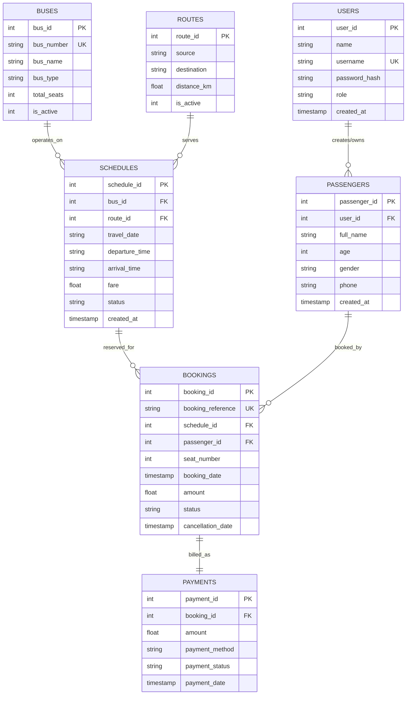

# Entity-Relationship (ER) Diagram
## Smart Bus Reservation System | DBMS Mini Project

### 1. Conceptual Schema Overview

The Smart Bus Reservation System is structured around **7 normalized relational tables** in SQLite, maintaining complete 3rd Normal Form (3NF) and referential integrity via foreign key constraints (`PRAGMA foreign_keys = ON;`).



---

### 2. Entity Descriptions and Attributes

#### A. `users`
- **Purpose**: Authenticates system users and manages role-based access control (`admin` vs `passenger`).
- **Primary Key**: `user_id` (INTEGER AUTOINCREMENT)
- **Alternate/Unique Key**: `username` (COLLATE NOCASE)
- **Integrity Constraints**: `CHECK(role IN ('admin', 'passenger'))`

#### B. `routes`
- **Purpose**: Physical point-to-point journey lines between Maharashtra cities.
- **Primary Key**: `route_id` (INTEGER AUTOINCREMENT)
- **Integrity Constraints**: `CHECK(trim(lower(source)) <> trim(lower(destination)))`, `CHECK(distance_km > 0)`

#### C. `buses`
- **Purpose**: Physical vehicle inventory, capacities, and coach categories.
- **Primary Key**: `bus_id` (INTEGER AUTOINCREMENT)
- **Alternate/Unique Key**: `bus_number` (COLLATE NOCASE)
- **Integrity Constraints**: `CHECK(total_seats > 0 AND total_seats <= 60)`, `CHECK(bus_type IN ('AC Sleeper', 'Non-AC Sleeper', 'AC Seater', 'Non-AC Seater', 'Volvo Multi-Axle'))`

#### D. `schedules`
- **Purpose**: Concrete journey events linking a specific bus to a route on a calendar date and time.
- **Primary Key**: `schedule_id` (INTEGER AUTOINCREMENT)
- **Foreign Keys**:
  - `bus_id` references `buses(bus_id)` ON DELETE RESTRICT
  - `route_id` references `routes(route_id)` ON DELETE RESTRICT
- **Integrity Constraints**: `CHECK(fare >= 0)`, `CHECK(status IN ('SCHEDULED', 'COMPLETED', 'CANCELLED'))`

#### E. `passengers`
- **Purpose**: Traveler demographic profile and contact information for boarding.
- **Primary Key**: `passenger_id` (INTEGER AUTOINCREMENT)
- **Foreign Key**: `user_id` references `users(user_id)` ON DELETE SET NULL (allows admin-created bookings)
- **Integrity Constraints**: `CHECK(age > 0 AND age <= 120)`

#### F. `bookings`
- **Purpose**: Atomic seat reservations with unique reference numbers and cancellation tracking.
- **Primary Key**: `booking_id` (INTEGER AUTOINCREMENT)
- **Alternate/Unique Key**: `booking_reference` (COLLATE NOCASE)
- **Foreign Keys**:
  - `schedule_id` references `schedules(schedule_id)` ON DELETE RESTRICT
  - `passenger_id` references `passengers(passenger_id)` ON DELETE RESTRICT
- **Special Partial Unique Index**:
  ```sql
  CREATE UNIQUE INDEX idx_bookings_active_seat
  ON bookings (schedule_id, seat_number)
  WHERE status = 'CONFIRMED';
  ```
  *Ensures active seat collision prevention while allowing seats from cancelled bookings to be rebooked without historical record deletion.*

#### G. `payments`
- **Purpose**: Simulated financial transaction ledger records.
- **Primary Key**: `payment_id` (INTEGER AUTOINCREMENT)
- **Foreign Key**: `booking_id` references `bookings(booking_id)` ON DELETE CASCADE
- **Integrity Constraints**: `CHECK(payment_status IN ('PAID', 'REFUND_PENDING', 'REFUNDED'))`

---

### 3. Cardinality & Relationships

| Entity 1 | Relationship | Entity 2 | Cardinality | Explanation |
| :--- | :--- | :--- | :--- | :--- |
| **users** | creates/owns | **passengers** | `1 : N` | A registered user account can maintain multiple passenger profiles or past tickets. |
| **buses** | is assigned to | **schedules** | `1 : N` | A single bus operates multiple scheduled journeys across calendar dates. |
| **routes** | is scheduled on | **schedules** | `1 : N` | A city route can have multiple departures each day. |
| **schedules** | contains | **bookings** | `1 : N` | A journey schedule contains up to its seat capacity of confirmed bookings. |
| **passengers**| reserves | **bookings** | `1 : N` | A traveler can reserve individual seats across multiple schedules. |
| **bookings** | generates | **payments** | `1 : 1` | Each booking transaction records an associated payment transaction record. |
