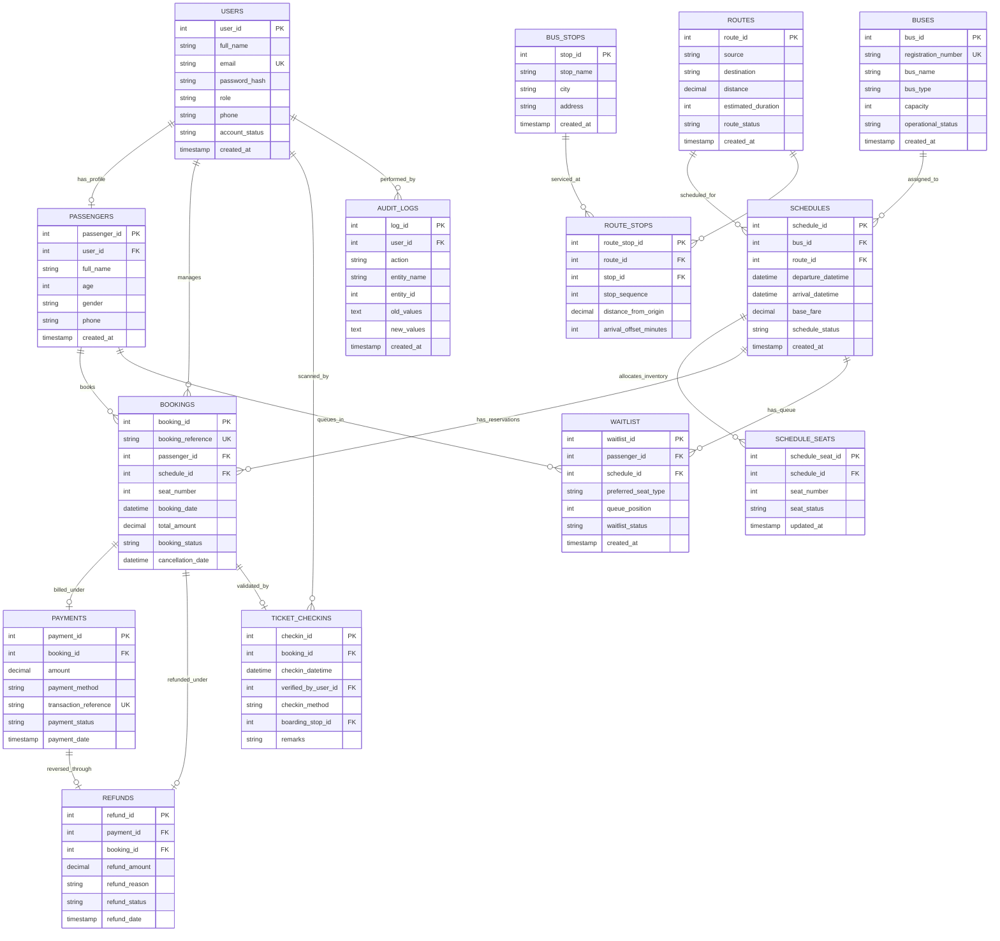

# Entity-Relationship (ER) Diagram
## Bus Reservation and Management System (BRMS) | DBMS Mini Project

---

### 1. Conceptual Schema Overview

The **Bus Reservation and Management System (BRMS)** is architected around **13 core relational entities** plus a centralized system **Audit Log**, modeled in pure **3rd Normal Form (3NF)** / **BCNF** with strict referential integrity (`ON DELETE RESTRICT` / `ON DELETE CASCADE` where appropriate) and relational constraints.

---

### 2. Entity Descriptions, Attributes, and Integrity Constraints

#### 1. `USERS`
- **Role**: Centralized identity and role-based authentication repository.
- **Primary Key**: `user_id` (INT AUTO_INCREMENT)
- **Alternate / Unique Key**: `email` (VARCHAR(150), UNIQUE)
- **Constraints**:
  - `role IN ('ADMIN', 'PASSENGER', 'CONDUCTOR')`
  - `account_status IN ('ACTIVE', 'SUSPENDED', 'DEACTIVATED')`
- **Cardinality**:
  - 1 : 0..1 with `PASSENGERS` (a user may have a passenger profile).
  - 1 : N with `TICKET_CHECKINS` (conductors record multiple ticket scans).
  - 1 : N with `AUDIT_LOGS` (users trigger audit actions).

#### 2. `PASSENGERS`
- **Role**: Profile details for travelers making reservations or joining waitlists.
- **Primary Key**: `passenger_id` (INT AUTO_INCREMENT)
- **Foreign Key**: `user_id -> USERS(user_id)` ON DELETE SET NULL
- **Constraints**:
  - `age >= 1 AND age <= 120`
  - `gender IN ('MALE', 'FEMALE', 'OTHER')`
- **Cardinality**:
  - 1 : N with `BOOKINGS` (a passenger makes multiple reservations).
  - 1 : N with `WAITLIST` (a passenger can waitlist on multiple trips).

#### 3. `BUSES`
- **Role**: Fleet assets operating on trips.
- **Primary Key**: `bus_id` (INT AUTO_INCREMENT)
- **Alternate / Unique Key**: `registration_number` (VARCHAR(20), UNIQUE)
- **Constraints**:
  - `capacity BETWEEN 10 AND 60`
  - `bus_type IN ('STANDARD', 'DELUXE', 'SLEEPER', 'AC_SEATER', 'VOLVO_MULTI_AXLE')`
  - `operational_status IN ('ACTIVE', 'MAINTENANCE', 'RETIRED')`
- **Cardinality**:
  - 1 : N with `SCHEDULES` (a bus operates many journey schedules).

#### 4. `ROUTES`
- **Role**: Journey corridors connecting origin and destination cities.
- **Primary Key**: `route_id` (INT AUTO_INCREMENT)
- **Constraints**:
  - `distance > 0`
  - `estimated_duration > 0`
  - `LOWER(TRIM(source)) <> LOWER(TRIM(destination))`
  - `route_status IN ('ACTIVE', 'INACTIVE')`
- **Cardinality**:
  - 1 : N with `SCHEDULES` (a route has many scheduled trips).
  - 1 : N with `ROUTE_STOPS` (a route contains ordered intermediate stops).

#### 5. `BUS_STOPS`
- **Role**: Physical stations, terminals, and pickup/drop points.
- **Primary Key**: `stop_id` (INT AUTO_INCREMENT)
- **Cardinality**:
  - 1 : N with `ROUTE_STOPS` (a bus stop can be part of multiple routes).
  - 1 : N with `TICKET_CHECKINS` (a stop serves as the boarding location).

#### 6. `ROUTE_STOPS` (Junction Entity)
- **Role**: Ordered sequence of stops along a route with distance and time offsets.
- **Primary Key**: `route_stop_id` (INT AUTO_INCREMENT)
- **Foreign Keys**:
  - `route_id -> ROUTES(route_id)` ON DELETE CASCADE
  - `stop_id -> BUS_STOPS(stop_id)` ON DELETE RESTRICT
- **Constraints**:
  - `UNIQUE (route_id, stop_sequence)` (strictly ordered sequence per route).
  - `UNIQUE (route_id, stop_id)` (prevents repeating the same stop within a route).
  - `stop_sequence >= 1`, `distance_from_origin >= 0`, `arrival_offset_minutes >= 0`.

#### 7. `SCHEDULES`
- **Role**: Concrete journey instances binding a bus and route to a specific departure/arrival time.
- **Primary Key**: `schedule_id` (INT AUTO_INCREMENT)
- **Foreign Keys**:
  - `bus_id -> BUSES(bus_id)` ON DELETE RESTRICT
  - `route_id -> ROUTES(route_id)` ON DELETE RESTRICT
- **Constraints**:
  - `arrival_datetime > departure_datetime`
  - `base_fare > 0`
  - `schedule_status IN ('SCHEDULED', 'BOARDING', 'IN_TRANSIT', 'COMPLETED', 'CANCELLED')`
- **Cardinality**:
  - 1 : N with `SCHEDULE_SEATS` (1 row per physical seat on the bus).
  - 1 : N with `BOOKINGS` (reservations booked on this schedule).
  - 1 : N with `WAITLIST` (passengers waiting for seat availability).

#### 8. `SCHEDULE_SEATS`
- **Role**: Authoritative real-time inventory of physical seat occupancy for each scheduled trip.
- **Primary Key**: `schedule_seat_id` (INT AUTO_INCREMENT)
- **Foreign Key**: `schedule_id -> SCHEDULES(schedule_id)` ON DELETE CASCADE
- **Constraints**:
  - `UNIQUE (schedule_id, seat_number)`
  - `seat_status IN ('AVAILABLE', 'BOOKED', 'BLOCKED')`
- **Concurrency Guarantee**: Provides explicit row-level locking via `SELECT ... FOR UPDATE` during booking transactions, completely preventing double-booking race conditions.

#### 9. `BOOKINGS`
- **Role**: Reservation transactions connecting a passenger to a schedule and seat.
- **Primary Key**: `booking_id` (INT AUTO_INCREMENT)
- **Alternate / Unique Key**: `booking_reference` (VARCHAR(30), UNIQUE, e.g. `BUS-20261031-A1B2`)
- **Foreign Keys**:
  - `passenger_id -> PASSENGERS(passenger_id)` ON DELETE RESTRICT
  - `schedule_id -> SCHEDULES(schedule_id)` ON DELETE RESTRICT
- **Constraints**:
  - `seat_number >= 1`
  - `total_amount >= 0`
  - `booking_status IN ('CONFIRMED', 'CANCELLED', 'CHECKED_IN', 'NO_SHOW')`
- **Partial Unique Index**:
  - `CREATE UNIQUE INDEX idx_bookings_active_seat ON bookings (schedule_id, seat_number) WHERE booking_status = 'CONFIRMED';`
  - Guarantees that active bookings cannot clash on the same seat while preserving cancelled bookings for historical reporting.

#### 10. `PAYMENTS`
- **Role**: Financial transaction ledger for customer payments.
- **Primary Key**: `payment_id` (INT AUTO_INCREMENT)
- **Alternate / Unique Key**: `transaction_reference` (VARCHAR(60), UNIQUE, e.g. `TXN-XXXXXXXX`)
- **Foreign Key**: `booking_id -> BOOKINGS(booking_id)` ON DELETE RESTRICT
- **Constraints**:
  - `amount >= 0`
  - `payment_method IN ('UPI', 'CREDIT_CARD', 'DEBIT_CARD', 'NET_BANKING', 'CASH')`
  - `payment_status IN ('PENDING', 'SUCCESS', 'FAILED', 'REFUNDED')`

#### 11. `REFUNDS`
- **Role**: Records cancellation penalties, refund percentages, and ledger reversals.
- **Primary Key**: `refund_id` (INT AUTO_INCREMENT)
- **Foreign Keys**:
  - `payment_id -> PAYMENTS(payment_id)` ON DELETE RESTRICT
  - `booking_id -> BOOKINGS(booking_id)` ON DELETE RESTRICT
- **Constraints**:
  - `refund_amount >= 0`
  - `refund_status IN ('PENDING', 'PROCESSED', 'FAILED')`

#### 12. `WAITLIST`
- **Role**: FIFO priority queue for passengers seeking seats on fully booked departures.
- **Primary Key**: `waitlist_id` (INT AUTO_INCREMENT)
- **Foreign Keys**:
  - `passenger_id -> PASSENGERS(passenger_id)` ON DELETE CASCADE
  - `schedule_id -> SCHEDULES(schedule_id)` ON DELETE CASCADE
- **Constraints**:
  - `queue_position >= 1`
  - `waitlist_status IN ('WAITING', 'ALLOCATED', 'EXPIRED', 'CANCELLED')`
  - `UNIQUE (passenger_id, schedule_id, waitlist_status)` where status = 'WAITING'.

#### 13. `TICKET_CHECKINS`
- **Role**: Onboard conductor verification ledger capturing QR scan timestamps and boarding status.
- **Primary Key**: `checkin_id` (INT AUTO_INCREMENT)
- **Foreign Keys**:
  - `booking_id -> BOOKINGS(booking_id)` ON DELETE RESTRICT
  - `verified_by_user_id -> USERS(user_id)` ON DELETE RESTRICT
  - `boarding_stop_id -> BUS_STOPS(stop_id)` ON DELETE SET NULL
- **Constraints**:
  - `checkin_method IN ('QR_SCAN', 'MANUAL')`
  - `UNIQUE (booking_id)` (prevents duplicate passenger check-ins on the same ticket).

#### 14. `AUDIT_LOGS`
- **Role**: Immutable system-wide change data capture (CDC) trail for security and regulatory compliance.
- **Primary Key**: `log_id` (INT AUTO_INCREMENT)
- **Foreign Key**: `user_id -> USERS(user_id)` ON DELETE SET NULL

---

### 3. Relationship Cardinality Matrix

| Parent Entity | Child Entity | Relationship Type | Cardinality | Referential Integrity Rule |
|---|---|---|---|---|
| `USERS` | `PASSENGERS` | Has profile | 1 : 0..1 | `ON DELETE SET NULL` |
| `USERS` | `TICKET_CHECKINS`| Scanned by | 1 : N | `ON DELETE RESTRICT` |
| `USERS` | `AUDIT_LOGS` | Performed by | 1 : N | `ON DELETE SET NULL` |
| `PASSENGERS` | `BOOKINGS` | Reserves | 1 : N | `ON DELETE RESTRICT` |
| `PASSENGERS` | `WAITLIST` | Queues in | 1 : N | `ON DELETE CASCADE` |
| `BUSES` | `SCHEDULES` | Operates on | 1 : N | `ON DELETE RESTRICT` |
| `ROUTES` | `SCHEDULES` | Scheduled for | 1 : N | `ON DELETE RESTRICT` |
| `ROUTES` | `ROUTE_STOPS` | Comprises | 1 : N | `ON DELETE CASCADE` |
| `BUS_STOPS` | `ROUTE_STOPS` | Serviced at | 1 : N | `ON DELETE RESTRICT` |
| `BUS_STOPS` | `TICKET_CHECKINS`| Boarded at | 1 : N | `ON DELETE SET NULL` |
| `SCHEDULES` | `SCHEDULE_SEATS`| Allocates | 1 : N | `ON DELETE CASCADE` |
| `SCHEDULES` | `BOOKINGS` | Booked for | 1 : N | `ON DELETE RESTRICT` |
| `SCHEDULES` | `WAITLIST` | Waitlisted for| 1 : N | `ON DELETE CASCADE` |
| `BOOKINGS` | `PAYMENTS` | Invoiced as | 1 : 1 | `ON DELETE RESTRICT` |
| `BOOKINGS` | `REFUNDS` | Refunded via | 1 : 0..1 | `ON DELETE RESTRICT` |
| `BOOKINGS` | `TICKET_CHECKINS`| Verified via | 1 : 0..1 | `ON DELETE RESTRICT` |
| `PAYMENTS` | `REFUNDS` | Reverses | 1 : 0..1 | `ON DELETE RESTRICT` |
